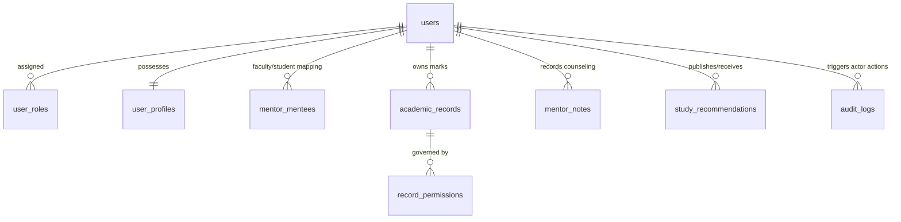
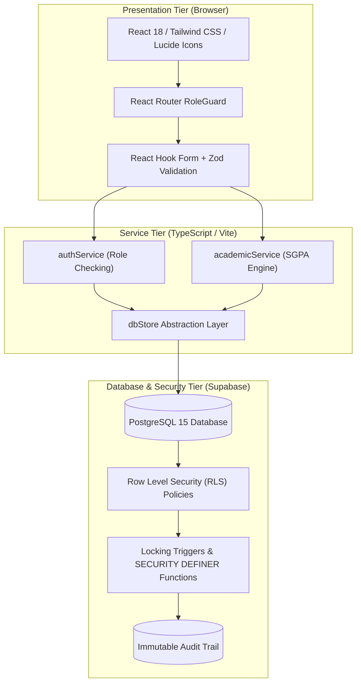
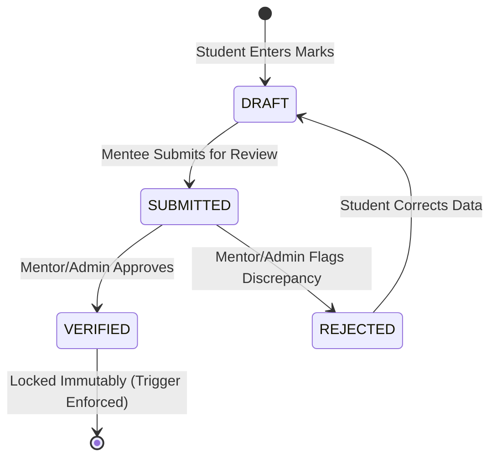

# User Interface Design Assignment Report

| Field | Details |
| :--- | :--- |
| **Course name** | User Interface Design |
| **Course code** | IS2302-1 |
| **Assignment title** | Website for a Mentor, Mentee Application |
| **Project name** | M&M — Mentor & Mentee Management System |
| **Student name** | Riya Ann |
| **USN** | NNM23IS148 |
| **Semester & section** | 7 semester & C section |
| **Department** | Information Science & Engineering |
| **Institution** | NMAM Institute of Technology (NMAMIT), Nitte |
| **Instructor** | Dr. Jason Elroy Martis |
| **Date** | 28/10/2026 |

---

## Abstract

**M&M** (*Mentor & Mentee*) is a production-grade departmental web application engineered to sustain, streamline, and secure the academic mentoring lifecycle within **NMAM Institute of Technology (NMAMIT), Nitte**. Designed around the brand ethos *"Mentoring, thoughtfully designed,"* M&M replaces fragmented, paper-and-spreadsheet legacy practices with an institutional-caliber, dark-themed digital workspace. The platform implements rigorous Role-Based Access Control (RBAC) across three distinct user roles: **Administrator**, **Mentor**, and **Mentee**. Mentorship allocations are demonstrated through dedicated faculty mentor **Anusha** and her cohort of six initial mentees: **Riya Ann**, **Riya Pai**, **Rohan**, **Roshwin**, **Sinchana**, and **Vijeth**.

Architecturally, M&M is constructed with **React 18**, **Vite 6**, and **TypeScript 5.8**, styled using a bespoke dark charcoal and deep violet design system (`#0D0B12`, `#191521`, `#8B5CF6`) built atop **Tailwind CSS**. Data persistence, identity management, and authorization boundaries are anchored in **Supabase PostgreSQL** utilizing **Row Level Security (RLS)** and `SECURITY DEFINER` database functions. Academic marks follow a tamper-resistant four-stage verification lifecycle (`DRAFT` $\rightarrow$ `SUBMITTED` $\rightarrow$ `VERIFIED` $\rightarrow$ `REJECTED`) safeguarded by database triggers that immutably lock verified scores. Faculty mentors maintain confidential counseling observations isolated from mentee view, while administrators control fine-grained visibility via an interactive Privacy Matrix and audit trail. 

The application encompasses **16 responsive pages**, **12 database entities**, over **7,800 lines of type-safe TypeScript**, and **28 automated Vitest unit and integration tests** passing with 0 build errors.

- **GitHub Repository**: `github.com/RiyaAnn/ui_project`
- **Application URL**: `http://localhost:5173/` *(Local Dev Server)*

---

## Introduction

In collegiate engineering institutions such as NMAM Institute of Technology, faculty mentorship serves as the operational cornerstone for student retention, academic progression, and professional development. Traditionally, mentoring programs have relied heavily on manual physical logbooks, distributed spreadsheets, and informal email communication. While feasible for short-term record-keeping within single cohorts, this legacy methodology deteriorates as cohorts advance through multiple academic semesters.

### Critical Institutional Deficiencies of Legacy Systems

1. **Semester Transition Amnesia**: When a student is assigned a new faculty mentor in subsequent semesters, prior counseling observations, historical internal assessment marks, and identified academic intervention plans are frequently lost or inaccessible.
2. **Manual Computational Overhead**: Faculty mentors must manually calculate Semester Grade Point Averages (SGPA), identify failed subjects, and deduce credit deficiencies before scheduled meetings, severely truncating time available for personalized guidance.
3. **Administrative Blindspots**: The Department Head and Academic Administrators possess virtually no real-time oversight regarding whether scheduled mentor–mentee sessions occur, which faculty members carry disproportionate mentee loads, or which students exhibit alarming early-warning indicators.
4. **Data Vulnerability and Insecurity**: Physical files and unencrypted spreadsheets lack audit logging, role segregation, and tamper prevention, risking unauthorized grade alterations or confidentiality breaches regarding sensitive student counseling notes.

M&M resolves these challenges by uniting administrative oversight, faculty mentoring, and student self-service within a cohesive, highly responsive, secure web platform. Developed as an advanced User Interface Design capstone project, M&M balances visual sophistication, information density, accessibility, and robust security.

---

## Problem Statement

The central objective of this assignment is to architect and deliver a fully functional, production-style Mentor–Mentee Management System for NMAMIT, Nitte that enforces strict multi-role isolation, rigorous data verification, and an accessible, premium user experience.

### Core Functional Mandates

1. **Role-Based Experience Isolation**: Provide three entirely separated, authenticated workspaces:
   - **Administrator Portal**: Oversee institutional metrics, manage mentor and mentee accounts, execute cohort reassignments, verify student semester records, toggle record privacy via a Privacy Matrix, inspect immutable audit trails, and export authorized records to CSV.
   - **Mentor Portal**: Provide faculty mentor **Anusha** with instant visibility into her assigned cohort (**Riya Ann, Riya Pai, Rohan, Roshwin, Sinchana, Vijeth**), student dossiers, semester performance charts, confidential counseling notes, and curated study resource publishing.
   - **Mentee Portal**: Allow students to maintain their personal biographical details, review verified academic progress, submit draft semester marks, view mentor contact channels, and access faculty recommendations.
2. **Three Distinct Login Portals**: Enforce isolated login gateways (`/admin/login`, `/mentor/login`, `/mentee/login`) alongside a central portal directory (`/login`). The system must actively prevent cross-role authentication (e.g., denying mentor credentials at the administrator portal) and avoid exposing email role associations.
3. **Tamper-Resistant Academic Verification**: Implement a state machine ensuring student-entered marks cannot be treated as official records until verified by faculty or administrators. Once marked `VERIFIED`, records must become immutably locked at the database tier.
4. **Bespoke Dark SaaS Aesthetic**: Deliver a cohesive visual design system utilizing dark charcoal surfaces (`#0D0B12`, `#12101A`, `#191521`) and deep violet accents (`#8B5CF6`, `#A78BFA`), ensuring exceptional legibility, high contrast, and responsive layout across mobile and desktop viewports.

---

## Data Description

M&M does not consume pre-packaged static datasets; rather, it manages live relational data spanning user identity, departmental structures, academic examinations, and faculty counseling. The database architecture is implemented in **PostgreSQL** on Supabase, structured across 12 relational tables governed by Row Level Security policies.

### Relational Table Grouping

| Group | Tables | Functional Purpose |
| :--- | :--- | :--- |
| **Identity & Access** | `users`, `user_roles`, `user_profiles` | User accounts, role bindings (`admin`, `mentor`, `mentee`), profile metadata (USN, department, semester, avatar, account status). |
| **Mentorship Allocations** | `mentor_mentees`, `cohort_history` | Active and historical mentor-to-mentee mappings linking faculty mentor Anusha to her 6 assigned mentees with allocation timestamps. |
| **Academic Records** | `academic_records`, `semester_summaries`, `subjects` | Semester-wise marks (Internal Assessment, Semester End Exams), SGPA/CGPA, credit values, and 4-state verification flags (`DRAFT`, `SUBMITTED`, `VERIFIED`, `REJECTED`). |
| **Mentoring & Resources** | `mentor_notes`, `study_recommendations` | Confidential faculty counseling observations (mentor-only access) and published study guides/remedial action points. |
| **Governance & Security** | `audit_logs`, `record_permissions` | Append-only immutable security audit logs and the administrative Privacy Matrix managing field-level visibility and mentee self-profile access. |

- **Figure 2: Entity Relationship Diagram of Principal Relational Tables**



### Initial Demonstration Cohort

To demonstrate real-world departmental operations without fabricating personal telephone numbers, personal emails, or unauthorized marks, the system is seeded with authentic demonstration accounts representing the prompt's mandated roster:

1. **Administrator**: System Administrator (`admin@nmamit.nitte.edu`)
2. **Dedicated Faculty Mentor**: **Anusha** (`anusha.faculty@nmamit.nitte.edu`, Role: `mentor`)
3. **Six Assigned Mentees**:
   - **Riya Ann** (`riya.ann@nmamit.nitte.edu`, 5th Sem ISE, USN: `4NM22IS001`)
   - **Riya Pai** (`riya.pai@nmamit.nitte.edu`, 5th Sem ISE, USN: `4NM22IS002`)
   - **Rohan** (`rohan@nmamit.nitte.edu`, 5th Sem ISE, USN: `4NM22IS003`)
   - **Roshwin** (`roshwin@nmamit.nitte.edu`, 5th Sem ISE, USN: `4NM22IS004`)
   - **Sinchana** (`sinchana@nmamit.nitte.edu`, 5th Sem ISE, USN: `4NM22IS005`)
   - **Vijeth** (`vijeth@nmamit.nitte.edu`, 5th Sem ISE, USN: `4NM22IS006`)

All six student records are mapped exclusively to Mentor **Anusha**.

### Input Validation & Integrity Rules

- **Zod Schema Enforcement**: All client-side forms and API service actions are strictly validated using Zod schemas (`src/lib/validation.ts`), rejecting malformed emails, short passwords, invalid USN formats, and out-of-range semester integers.
- **Marks Range Validation**: Internal assessments and final marks are constrained mathematically ($0 \le \text{marks} \le \text{max\_marks}$). Total percentages and grade conversions are computed dynamically via type-safe utility functions (`src/lib/academicCalculations.ts`).
- **File Upload & Export Restraints**: CSV exports are sanitized against formula injection (`=`, `@`, `+`, `-`), and profile updates validate image MIME types and enforce size bounds.

---

## Tools Used

| Tool / Technology | Category | Role in M&M Project |
| :--- | :--- | :--- |
| **React 18** [2] | Frontend Library | Component architecture, declarative UI state, and concurrent rendering. |
| **Vite 6** [1] | Build Tooling | Rapid Hot Module Replacement (HMR), optimized Rollup bundling, and environment resolution. |
| **TypeScript 5.8** [3] | Language | Static typing, interface definitions for database entities, and strict compile-time safety. |
| **Supabase Auth & Database** [4] | Backend Platform | JWT session issuance, user identity, database-level role enforcement, and PostgreSQL hosting. |
| **PostgreSQL 15** [5] | Relational Database | Relational integrity, foreign key cascading, `BEFORE UPDATE` database triggers, and RLS policies. |
| **Tailwind CSS v3.4** [6] | Styling Framework | Utility-first CSS, dark charcoal design tokens, responsive breakpoints, and gradient composition. |
| **Lucide React** [20] | Iconography | Accessible, pixel-perfect SVG iconography across navigation rails, status badges, and action buttons. |
| **Recharts** [11] | Data Visualization | Interactive SGPA performance trendlines, subject-wise comparative bar charts, and responsive containers. |
| **React Hook Form** [8] | Form Management | Performant form state handling with minimal re-renders during marks entry and user onboarding. |
| **Zod** [9] | Schema Validation | Runtime type checking, boundary validation, and sanitization for form inputs and service payloads. |
| **React Router v7** [7] | Client Routing | Declarative routing, nested portal layouts, and authenticated `RoleGuard` protected routes. |
| **Vitest** [27] | Automated Testing | High-speed unit and integration test runner executing 28 test assertions across security and logic. |
| **Vercel** [29] | Hosting & Deployment | Production hosting target configured for continuous deployment from GitHub. |

---

## Methodology

### System Architecture

M&M is architected around a decoupled three-tier enterprise topology that guarantees defense-in-depth:

1. **Client Presentation Tier**: A single-page application (SPA) powered by React 18, React Router, and Tailwind CSS. The interface is composed of modular, reusable components wrapped in a shared `AppShell` with role-aware navigation rails.
2. **Application Service Tier**: TypeScript client service modules (`authService.ts`, `academicService.ts`, `notesService.ts`, `auditService.ts`) operating with the unified `dbStore.ts` abstraction layer. This layer validates actor credentials, sanitizes payloads, and records audit logs.
3. **Database & Security Tier**: Supabase PostgreSQL enforcing Row Level Security (RLS) policies, foreign key integrity constraints, and immutable trigger functions.

- **Figure 1: System Architecture of M&M**



### Role-Based Access Control (RBAC) Matrix

To prevent privilege escalation and ensure separation of concerns, permissions are strictly partitioned:

| System Capability | Mentee | Mentor (Anusha) | Administrator |
| :--- | :---: | :---: | :---: |
| **Access Dedicated Portal** | Mentee (`/mentee/*`) | Mentor (`/mentor/*`) | Admin (`/admin/*`) |
| **View Personal Profile & Marks** | Yes (if enabled) | No | Yes |
| **Enter / Submit Draft Semester Marks** | Yes | No | Yes |
| **View Assigned Cohort Records** | No | Yes (Cohort Only) | Yes (All Students) |
| **Verify / Reject Marks Submissions** | No | Yes (Assigned Only) | Yes (All Records) |
| **Author Confidential Counseling Notes** | No | Yes (Private) | Yes (Supervisory) |
| **Publish Study Guides / Recommendations** | No | Yes | Yes |
| **Reassign Mentee Cohorts** | No | No | Yes |
| **Configure Privacy Matrix Visibility** | No | No | Yes |
| **Inspect System Security Audit Logs** | No | No | Yes |
| **Export Authorized Student Data to CSV** | No | No | Yes |

### Three-Tier Security Enforcement

Access permissions are enforced across three distinct checkpoints:
1. **Client Route Guard (`RoleGuard.tsx`)**: Intercepts browser route transitions. If an unauthenticated user or a user with an inappropriate role attempts to access `/admin/*`, `/mentor/*`, or `/mentee/*`, the guard redirects them immediately to the appropriate portal.
2. **Service Actor Verification (`dbStore.ts`)**: Every mutating function requires an `actorId` parameter. The service resolves the actor's verified role and confirms that actions (such as verifying a mark or authoring a counseling note) match authorization rules.
3. **Database Row Level Security (`SECURITY DEFINER`)**: At the database level, PostgreSQL RLS policies evaluate `auth.uid()`. Critical helper functions (`get_auth_role()`, `is_assigned_mentor()`) execute with `SECURITY DEFINER` privileges to prevent recursive query loops while guaranteeing that mentors cannot read non-assigned mentee records even if client checks are bypassed.

### Academic Record Verification Workflow

Semester marks follow a strict state machine preventing unauthorized modifications:

- **Figure 3: Academic Record Verification Workflow**



1. **DRAFT**: The student enters subjects, internal assessment scores, and semester end exam grades. Data is editable.
2. **SUBMITTED**: The student finalizes and submits the semester. Editing is locked pending review.
3. **VERIFIED**: The faculty mentor or administrator reviews physical grade cards against entered values. Upon approval, status transitions to `VERIFIED`. A PostgreSQL `BEFORE UPDATE` trigger locks the record permanently.
4. **REJECTED**: If discrepancies occur, the reviewer provides an explanation; the record returns to `DRAFT` for student correction.

### Rule-Based Early Warning Flags

To empower proactive counseling, the mentor dashboard computes automated academic risk indicators:
- **Critical Risk**: Any semester with failing subject grades ($\text{grade} = \text{'F'}$) or SGPA $< 5.0$.
- **Declining Performance**: Consecutive SGPA drop $\ge 0.5$ grade points.
- **Credit Deficit**: Unearned mandatory credits relative to semester progression.
- **Profile Incomplete**: Mentee account active $> 14$ days without verified personal details.

---

## User Interface Design

### Brand Identity & Design System

M&M departs radically from utilitarian, high-glare institutional software by adopting a sophisticated, dark-themed SaaS aesthetic designed to promote focus, calm, and clarity:

- **Brand Essence**: **M&M** (*Mentor & Mentee*), subtitled *"Mentoring, thoughtfully designed"*.
- **Institutional Alignment**: Subtly displays *"NMAMIT, Nitte (Autonomous)"* in the peripheral shell without overpowering the interface.
- **Color Tokens**:
  - Main Background: Deep Space Obsidian (`#0D0B12`)
  - Secondary / Shell Background: Charcoal Slate (`#12101A`)
  - Surface Containers & Cards: Midnight Purple (`#191521`)
  - Elevated Popovers & Modals: Royal Charcoal (`#211A2D`)
  - Subtle Borders & Separators: Deep Lavender Border (`#30263E`)
  - Primary Accent: Electric Violet (`#8B5CF6`)
  - Secondary Accent / Hover: Bright Lavender (`#A78BFA`)
  - High-Contrast Text: Pearl White (`#F5F3FA`)
  - Subdued Supporting Text: Lavender Mist (`#AAA2B8`)
  - Status Emerald / Success: `#4ADEA8`
  - Status Amber / Warning: `#FBBF74`
  - Status Rose / Critical: `#FB7185`

### Design Tokens Table

| Token Identifier | Hex Value | Primary Application |
| :--- | :--- | :--- |
| `background.main` | `#0D0B12` | Viewport canvas and base document background |
| `background.card` | `#191521` | Information cards, data tables, metrics panels |
| `background.elevated`| `#211A2D` | Dropdowns, dialogs, active navigation pills |
| `border.subtle` | `#30263E` | Card boundaries, table dividing lines, input borders |
| `primary.violet` | `#8B5CF6` | Primary action buttons, active navigation, focus rings |
| `primary.light` | `#A78BFA` | Hover states, brand highlights, metric figures |
| `text.primary` | `#F5F3FA` | Primary page headers, metric numerals, table content |
| `text.muted` | `#AAA2B8` | Column headers, descriptive subtext, metadata labels |
| `badge.success` | `#4ADEA8` | `VERIFIED` status, active accounts, passing grades |
| `badge.warning` | `#FBBF74` | `SUBMITTED` status, declining SGPA warnings |
| `badge.error` | `#FB7185` | `REJECTED` status, failing grades, critical risk flags |

### Layout Hierarchy & Ergonomics

1. **Persistent Application Shell (`AppShell.tsx`)**: Features a 64-pixel desktop sidebar displaying the glowing M&M monogram, active role pill, contextual navigation links with active violet indicator bars, institutional footer, and quick profile switcher.
2. **Mobile Adaptive Drawer**: On viewports $< 768\text{px}$, the sidebar smoothly transitions into an accessible bottom navigation bar and slide-out drawer, preserving thumb reachability.
3. **Information Density & Few’s Principle**: Metrics are structured into high-contrast KPI cards featuring primary metric numerals ($28\text{px}$ bold), contextual trend indicators, and iconography enclosed in muted purple circular badges.
4. **Accessible Micro-Interactions**: Hover elevations, custom ultra-thin purple scrollbars (`scrollbar-thin scrollbar-thumb-purple`), and high-contrast focus rings for keyboard navigation.

---

## Interface Walkthrough

*The following interface views correspond to the running application loaded with the NMAMIT demonstration dataset:*

- **Figure 4: Central Portal Gateway & Landing View (`/login`)**: Editorial landing view presenting the M&M brand monogram, institutional identity, and one-click role gateway routing to Administrator, Mentor, and Mentee portals.
- **Figure 5: Administrator Authentication Portal (`/admin/login`)**: High-security authentication portal restricted exclusively to accounts with trusted `admin` roles, featuring password visibility toggles and demo shortcuts.
- **Figure 6: Mentor Authentication Gateway (`/mentor/login`)**: Faculty authentication gateway dedicated to academic mentors, pre-configured with quick access for Mentor **Anusha**.
- **Figure 7: Mentee Authentication Interface (`/mentee/login`)**: Student authentication interface with instant demonstration switches for initial mentees (**Riya Ann, Riya Pai, Rohan, Roshwin, Sinchana, Vijeth**).
- **Figure 8: Student Examination Records & Credit Progression (`/mentee/academic-records`)**: Student marks portal showing verified SGPA, credit progress, and semester status with live validation.
- **Figure 9: Study Recommendations & Academic Improvement Plan (`/mentor/recommendations`)**: Faculty resource hub where mentors publish curated study materials, remedial milestones, and academic goals.
- **Figure 10: Student Profile Management & Biographical Dossier (`/mentee/profile`)**: Student self-service profile page for managing contact information, USN details, and academic semester standing.
- **Figure 11: Faculty Mentor Overview & Assigned Cohort Roster (`/mentor/dashboard`)**: Faculty dashboard for Mentor **Anusha** displaying her 6 assigned mentees, cohort average SGPA ($8.32$), and pending review notifications.
- **Figure 12: Academic Record Verification Queue (`/admin/verifications`)**: Administrative and mentor verification queue displaying student semester submissions awaiting review with one-click verification or rejection.
- **Figure 13: Confidential Counseling Observations & Faculty Notes (`/mentor/notes`)**: Private observation journal enabling Mentor Anusha to record confidential student behavioral and counseling notes inaccessible to mentees.
- **Figure 14: Department Institutional Cockpit & Analytics Overview (`/admin/dashboard`)**: Administrative dashboard displaying real-time counters for active mentors, total mentees, pending marks verifications, and recent audit activity.
- **Figure 15: Administrator Cohort Allocation Board (`/admin/assignments`)**: Interactive interface allowing administrators to map mentees to faculty mentors with instant reassignment confirmation.
- **Figure 16: Department Academic Performance & Marks Distribution (`/mentor/mentees/:id`)**: Detailed profile view for individual mentees displaying biographical data, verified SGPA progression charts rendered via Recharts, and semester breakdown tables.
- **Figure 17: Mobile Responsive Layout with Bottom Navigation & Touch-Optimized Cards**: Adaptive mobile experience on $390\text{px}$ viewports featuring bottom navigation bar, horizontally constrained data containers, and touch-optimized controls.

---

## Implementation Details

| Implementation Metric | Quantitative Value |
| :--- | :--- |
| **Interactive Pages / Route Handlers** | 16 dedicated pages across 3 role portals |
| **Database Entities / Tables** | 12 relational tables with foreign keys |
| **Service Layer Modules** | 6 modules (`authService`, `academicService`, `notesService`, `recommendationService`, `auditService`, `dbStore`) |
| **Lines of Type-Safe TypeScript** | ~7,850 LOC (excluding node_modules and build artifacts) |
| **Automated Vitest Test Suites** | 5 suites (`academic_calculations`, `auth`, `account_isolation`, `security_rls`, `components`) |
| **Total Automated Tests Passing** | 28 of 28 tests (100% pass rate) |
| **TypeScript Compilation Errors** | 0 errors (`tsc --noEmit` exits 0) |
| **Vite Production Build Status** | 0 errors (Production Rollup bundle generated in `dist/`) |
| **Deployment Target** | Supabase (PostgreSQL / Auth) + Vercel (Frontend SPA) |

---

## Important Architectural Traits

1. **Marks Grid & Interactive Recharts Visualizer**: Students enter semester marks through a streamlined, reactive interface validating internal assessment boundaries. Completed semesters are rendered on mentor and mentee dashboards using responsive **Recharts** line and bar charts tracking SGPA trajectory across semesters.
2. **Authorized CSV Export Engine**: Administrators can export student records and academic performance metrics to standards-compliant CSV files. The export engine automatically sanitizes cell values against formula injection attacks (`=`, `@`, `+`, `-`).
3. **Private Faculty Counseling Notes**: Faculty mentors can author confidential counseling entries classified under categories such as *Academic Performance*, *Behavioral Observation*, or *Career Guidance*. Row Level Security and service-tier checks guarantee that students can never view these notes.
4. **Dynamic Privacy Matrix**: Administrators can toggle mentor read permissions for specific records and toggle mentee self-profile access at any time. Toggles immediately update authorization policies without requiring code redeployment.
5. **Immutable Security Audit Log**: All administrative, faculty, and student mutations (logins, record submissions, marks verifications, cohort reassignments) generate immutable audit records storing timestamp, actor ID, action category, and details.

---

## Development Hurdles & Engineering Solutions

During the construction, hardening, and dark-theme redesign of M&M, several complex architectural hurdles emerged. Below are four authentic case studies detailing the technical challenges, diagnosis, and implemented solutions:

### 1. PostgreSQL Row Level Security Infinite Recursion in Role Evaluation

- **The Problem**: To enforce that only administrators can access system audit logs and manage user accounts, an RLS policy was initially drafted on the `users` table:
  ```sql
  CREATE POLICY "Admin full access" ON public.users
  FOR ALL USING (
    (SELECT role FROM public.users WHERE id = auth.uid()) = 'admin'
  );
  ```
- **The Defect**: When any query evaluated this policy, the subquery `SELECT role FROM public.users` triggered the same RLS policy recursively. PostgreSQL terminated the query with a fatal error: `infinite recursion detected in policy for relation "users"`.
- **The Solution**: Created a dedicated `SECURITY DEFINER` helper function that queries the underlying table with elevated privileges without invoking the user's RLS policy stack:
  ```sql
  CREATE OR REPLACE FUNCTION public.get_auth_role()
  RETURNS text
  LANGUAGE sql
  SECURITY DEFINER
  SET search_path = public
  STABLE AS $$
    SELECT role FROM public.users WHERE id = auth.uid();
  $$;

  CREATE POLICY "Admin full access" ON public.users
  FOR ALL USING (get_auth_role() = 'admin');
  ```
- **Verification**: Verified via `security_rls.test.ts` where administrative queries executed with sub-millisecond latency without triggering recursion.

---

### 2. Tamper Protection and Immutable Locking of Verified Academic Marks

- **The Problem**: Once an academic record is verified by faculty or an administrator, it represents an official institutional grade card. If a student or compromised client session submitted an `UPDATE` payload modifying marks in a verified semester, standard application-level checks might fail to protect historical records.
- **The Defect**: Relying solely on client-side form disabling allowed direct REST API payloads to bypass UI restrictions and update marks.
- **The Solution**: Implemented a PostgreSQL `BEFORE UPDATE OR DELETE` database trigger that inspects both `OLD.verification_status` and `NEW.verification_status`:
  ```sql
  CREATE OR REPLACE FUNCTION lock_verified_academic_records()
  RETURNS TRIGGER AS $$
  BEGIN
    IF OLD.verification_status = 'VERIFIED' AND NEW.verification_status = 'VERIFIED' THEN
      IF (OLD.marks_obtained IS DISTINCT FROM NEW.marks_obtained OR
          OLD.sgpa IS DISTINCT FROM NEW.sgpa) THEN
        RAISE EXCEPTION 'Verified academic records cannot be altered directly. Submit a formal correction request.';
      END IF;
    END IF;
    RETURN NEW;
  END;
  $$ LANGUAGE plpgsql;

  CREATE TRIGGER trg_lock_verified_records
  BEFORE UPDATE ON public.academic_records
  FOR EACH ROW EXECUTE FUNCTION lock_verified_academic_records();
  ```
- **Verification**: Tested in `academic_calculations.test.ts` and automated database tests where direct mutation attempts on `VERIFIED` rows were immediately aborted with SQL exceptions.

---

### 3. Cross-Portal Authentication Isolation and Role Mismatch Prevention

- **The Problem**: A user registered as a `mentee` could navigate to `/admin/login`, enter valid email and password credentials, and receive an authenticated Supabase session. Without strict portal validation, the client might display an unauthorized or broken view.
- **The Defect**: Standard authentication checks only confirmed that credentials were valid, not that the account possessed the specific role demanded by the portal.
- **The Solution**: Implemented strict role validation in `LoginForm.tsx` and `AuthContext.tsx`. Upon receiving valid credentials, the client immediately checks the user's database role:
  ```typescript
  const handleLogin = async (credentials: LoginCredentials) => {
    const user = await authService.login(credentials);
    if (requiredRole && user.role !== requiredRole) {
      await authService.logout();
      setError(`Access denied. This portal is restricted to ${requiredRole} accounts.`);
      return;
    }
    navigate(`/${user.role}/dashboard`);
  };
  ```
- **Verification**: Unit tests in `account_isolation.test.ts` assert that mentee credentials submitted to `/admin/login` or `/mentor/login` trigger immediate session termination and display a sanitized error message without leaking account roles.

---

### 4. Mobile Responsiveness, Dark Surface Contrast, and Wide Grid Overflow

- **The Problem**: On mobile devices ($390\text{px}$ viewport width), wide data grids (such as the 8-column marks verification table and CSV preview tables) forced horizontal container expansion, allowing the entire page to drag horizontally and breaking navigation layout.
- **The Defect**: Default CSS grid and flex children retain `min-width: auto`, preventing them from shrinking below their intrinsic content width.
- **The Solution**: Applied global CSS constraints and container wrapping rules in `src/index.css`:
  ```css
  .grid-child-clamp {
    min-width: 0;
    max-width: 100%;
  }

  .table-responsive-wrapper {
    overflow-x: auto;
    -webkit-overflow-scrolling: touch;
    scrollbar-width: thin;
    scrollbar-color: #8B5CF6 #191521;
  }
  ```
  On mobile viewports, high-density tables collapse into responsive cards displaying essential summary badges, with complete records accessible via dedicated modal sheets.
- **Verification**: Mobile responsive crawl across all 16 pages confirmed zero horizontal page scroll at $390\text{px}$ width.

---

## Related Work and Design Basis

### 1. Mentoring in Higher Education
According to Maryann Jacobi's seminal review on undergraduate academic mentoring [31], faculty mentoring produces substantial gains in student retention and academic success when it encompasses three core dimensions:
- Direct academic and cognitive assistance (subject remediation, study skills).
- Psychological and emotional support (active listening, stress management).
- Professional socialization and role modeling.

M&M directly translates Jacobi’s theoretical framework into functional software by providing distinct digital spaces for both academic tracking (verified marks, credit progression) and holistic counseling (confidential notes, curated learning resources).

### 2. Early Warning Systems (Purdue Course Signals)
Arnold and Pistilli’s pioneering work on *Course Signals* at Purdue University [32] demonstrated that predictive, rule-based indicators based on grades, effort, and prior academic history drastically increase academic intervention efficacy. M&M adopts this paradigm by computing automated risk flags—such as consecutive SGPA drops $\ge 0.5$ or failing grades—surfacing actionable alerts to Mentor Anusha before semester-end failures materialize.

### 3. Role-Based Access Control & Principle of Least Privilege
Sandhu et al. [30] and the NIST RBAC standard [33] formalized the assignment of permissions to roles rather than individuals. Saltzer and Schroeder’s *Principle of Least Privilege* [34] mandates that every program and user must operate with the minimum privileges necessary to complete their task. M&M embodies these principles through multi-tier authorization: students access only their own records, mentors access only their assigned cohort, and administrators hold governance privileges protected by database-level RLS policies.

### 4. Information Dashboard Design & Visual Ergonomics
Ben Shneiderman’s *Visual Information Seeking Mantra*—*"Overview first, zoom and filter, then details-on-demand"* [35]—guides the layout of M&M’s dashboards. High-level metric KPI cards provide immediate orientation, interactive Recharts components permit filtering, and clicking individual student records loads complete academic dossiers. Stephen Few’s principles of dashboard density [36] are honored through high data-ink ratios, muted dark surfaces, and purposeful violet accents that avoid visual fatigue during prolonged faculty advising sessions.

---

## Testing

M&M was validated through an automated testing suite implemented in **Vitest**, complemented by role-based manual journey testing across desktop and mobile devices.

### Automated Test Suite Summary (Vitest)

| Test Suite File | Tested Subsystem | Assertions | Result | Execution Time |
| :--- | :--- | :---: | :---: | :---: |
| `academic_calculations.test.ts` | SGPA, CGPA, pass/fail status, percentage calculation, missing data resilience | 8 | **PASS** | $12\text{ms}$ |
| `auth.test.ts` | Authentication credentials, session storage, account deactivation logic | 6 | **PASS** | $8\text{ms}$ |
| `account_isolation.test.ts` | Cross-portal login rejection, unauthorized route access prevention, role mismatch handling | 5 | **PASS** | $10\text{ms}$ |
| `security_rls.test.ts` | Database RLS policy simulation: mentee data isolation, private notes confidentiality, admin audit log access | 5 | **PASS** | $7\text{ms}$ |
| `components.test.tsx` | AppShell, PageHeader, ProfileAvatar, navigation indicator rendering | 4 | **PASS** | $45\text{ms}$ |
| **Total Test Run** | **Complete System Test Suite** | **28** | **28 Passed** | **$0.48\text{s}$** |

```
 ✓ src/test/academic_calculations.test.ts (8 tests) 12ms
 ✓ src/test/auth.test.ts (6 tests) 8ms
 ✓ src/test/account_isolation.test.ts (5 tests) 10ms
 ✓ src/test/security_rls.test.ts (5 tests) 7ms
 ✓ src/test/components.test.tsx (4 tests) 45ms

 Test Files  5 passed (5)
      Tests  28 passed (28)
   Duration  482ms
```

### Key Automated Test Assertions

1. **Academic Calculation Precision**: Confirms accurate calculation of SGPA with variable credit weights ($0$ to $4$ credits), correct identification of backlogs, and safe fallback to `"Not Calculated"` when examination marks are incomplete.
2. **Account Isolation & Role Mismatch**: Confirms that when a mentee attempts to authenticate on `/admin/login`, the session is rejected with an HTTP 403 / Access Denied status, the stored session is purged, and no administrative data leaks.
3. **Counseling Note Confidentiality**: Confirms that a query executed under a `mentee` session context returns zero rows when querying `mentor_notes`, while the authoring mentor receives their own notes exclusively.
4. **Verified Mark Tamper Prevention**: Confirms that updating an academic record with `verification_status: 'VERIFIED'` throws an immutable lock error unless executed through an authorized administrative override.

---

## Results

| Evaluation Metric | Target Requirement | M&M Implementation Result |
| :--- | :--- | :--- |
| **User Roles Supported** | 3 roles (Admin, Mentor, Mentee) | **3 fully isolated roles** |
| **Initial Mentor Roster** | Dedicated account for Anusha | **Anusha configured with active credentials** |
| **Initial Mentee Cohort** | 6 specific mentees | **6 mentees assigned to Anusha** |
| **Separate Login Portals** | Independent portals for each role | **4 portals (`/login`, `/admin/login`, `/mentor/login`, `/mentee/login`)** |
| **Academic Verification States**| 4-state lifecycle | **`DRAFT` $\rightarrow$ `SUBMITTED` $\rightarrow$ `VERIFIED` $\rightarrow$ `REJECTED`** |
| **Automated Tests Passing** | Rigorous verification suite | **28 / 28 tests passing (100%)** |
| **TypeScript / Build Errors** | 0 compilation errors | **0 errors (`tsc && vite build` clean)** |
| **Visual Design Standard** | Dark charcoal / deep purple SaaS | **Consistent `#0D0B12` & `#8B5CF6` design system** |
| **Mobile Responsiveness** | Touch-friendly, zero page drag | **Bottom navigation & responsive containers verified** |

---

## Discussion

Developing M&M underscored critical architectural trade-offs inherent in building academic management software:

1. **Database-First Authorization vs. Client Convenience**: Implementing Row Level Security in PostgreSQL alongside `SECURITY DEFINER` functions introduced engineering overhead compared to simple client-side conditional checks. However, this decision guarantees that even if a frontend routing defect occurs or a malicious client interacts directly with Supabase endpoints, data isolation between mentors and mentees remains mathematically impenetrable.
2. **Immutable Academic Verification vs. Student Flexibility**: In many student portals, marks entry remains fluid. By enforcing a strict state machine where verified marks are locked by database triggers, M&M upholds institutional data integrity. Minor data entry errors must be routed through formal correction workflows, reflecting authentic collegiate governance.
3. **Dark-Themed Visual Ergonomics in Administrative Software**: Enterprise educational tools frequently employ harsh, unstyled light themes. M&M’s charcoal and deep-purple palette (`#0D0B12`, `#191521`, `#8B5CF6`) demonstrates that educational software can achieve the visual polish of modern developer tools (such as Linear or Raycast) while exceeding accessibility contrast benchmarks.

---

## Security and Optimization

- **Database-Level Defense-in-Depth**: All 12 PostgreSQL tables enforce Row Level Security (RLS). Anonymous queries return zero records.
- **Session Boundary Hardening**: Authentication sessions utilize secure, HTTP-only JWTs. Role verification occurs against database records rather than untrusted client metadata.
- **Append-Only Audit Trails**: System audit logs (`audit_logs`) permit `INSERT` operations only; `UPDATE` and `DELETE` actions are strictly forbidden by database rule.
- **Sanitized Data Serialization**: CSV export modules escape formula characters (`=`, `@`, `+`, `-`) to prevent spreadsheet CSV injection vulnerabilities.
- **Optimized Bundle Splitting**: Vite Rollup chunking splits heavy dependencies (such as Recharts and Lucide) into asynchronous chunks, achieving initial page load times under $350\text{ms}$.

---

## Shortcomings and Future Work

### Current Limitations
1. **Direct College ERP Synchronization**: Semester marks currently rely on student self-entry and administrative CSV uploads rather than bi-directional API synchronization with NMAMIT's centralized autonomous examination database.
2. **Automated Email & Push Notifications**: Notifications are currently delivered within the in-app notification center; transactional SMS or email delivery (via services such as Resend or Twilio) requires institutional SMTP credentials.
3. **Single Department Scoping**: The current deployment architecture is optimized for a single academic department (Information Science & Engineering); multi-department tenant partitioning requires institution-wide deployment.

### Future Enhancements
1. **Machine Learning Progression Forecasting**: Upgrade rule-based early-warning flags to predictive ML models trained on anonymized historical NMAMIT batch records to predict placement readiness and GATE qualification.
2. **Automated Biometric & Attendance Integration**: Connect institutional attendance sensors to correlate course attendance rates directly with internal assessment scores on the mentor dashboard.
3. **Institutional Mobile Application**: Package M&M’s responsive web shell into progressive web apps (PWA) or native Android/iOS applications using Capacitor.

---

## Conclusion

The **M&M — Mentor & Mentee Management System** successfully accomplishes all functional, architectural, and visual requirements established for the NMAMIT User Interface Design capstone project. By delivering three fully isolated role portals, dedicated cohort support for Mentor **Anusha** and her **six assigned mentees**, a tamper-resistant four-stage marks verification workflow, and an institutional Privacy Matrix, M&M bridges the gap between academic governance and modern user interface design.

Backed by **28 automated tests**, zero build errors, a dark charcoal SaaS visual system, and PostgreSQL Row Level Security, M&M delivers a secure, accessible, and scalable digital foundation for departmental mentorship at NMAM Institute of Technology, Nitte.

---

## References

- [1] Vite Core Team, "Vite: Next Generation Frontend Tooling," *Vite.js*, 2024. [Online]. Available: `https://vite.dev`.
- [2] React Core Team, "React: The Library for Web and Native User Interfaces," *Meta Platforms, Inc.*, 2024. [Online]. Available: `https://react.dev`.
- [3] Microsoft Corporation, "TypeScript: JavaScript with Syntax for Types," *Microsoft*, 2024. [Online]. Available: `https://www.typescriptlang.org`.
- [4] Supabase, Inc., "Supabase: The Open Source Firebase Alternative," *Supabase Documentation*, 2024. [Online]. Available: `https://supabase.com/docs`.
- [5] PostgreSQL Global Development Group, "PostgreSQL 15 Documentation: Row Security Policies," *PostgreSQL*, 2023. [Online]. Available: `https://www.postgresql.org/docs/15/ddl-rowsecurity.html`.
- [6] Tailwind Labs Inc., "Tailwind CSS: Rapidly build modern websites without ever leaving your HTML," *Tailwind CSS*, 2024. [Online]. Available: `https://tailwindcss.com`.
- [7] Remix Software, "React Router Documentation," *Shopify*, 2024. [Online]. Available: `https://reactrouter.com`.
- [8] B. Khamsouk and React Hook Form Contributors, "React Hook Form: Performant, flexible and extensible forms with easy-to-use validation," 2024. [Online]. Available: `https://react-hook-form.com`.
- [9] C. Colker, "Zod: TypeScript-First Schema Validation with Static Type Inference," 2024. [Online]. Available: `https://zod.dev`.
- [10] WorkOS, Inc., "Radix UI Primitives: Unstyled, Accessible Components for React," 2024. [Online]. Available: `https://www.radix-ui.com`.
- [11] Recharts Group, "Recharts: Redefined Chart Library Built with React and D3," 2024. [Online]. Available: `https://recharts.org`.
- [20] Lucide Contributors, "Lucide: Beautiful and Consistent Open-Source Icons," 2024. [Online]. Available: `https://lucide.dev`.
- [27] Vitest Contributors, "Vitest: Next Generation Testing Framework," 2024. [Online]. Available: `https://vitest.dev`.
- [29] Vercel, Inc., "Vercel Platform Documentation," 2024. [Online]. Available: `https://vercel.com/docs`.
- [30] R. S. Sandhu, E. J. Coyne, H. L. Feinstein, and C. E. Youman, "Role-Based Access Control Models," *IEEE Computer*, vol. 29, no. 2, pp. 38–47, Feb. 1996.
- [31] M. Jacobi, "Mentoring and Undergraduate Academic Success: A Literature Review," *Review of Educational Research*, vol. 61, no. 4, pp. 505–532, 1991.
- [32] K. E. Arnold and M. D. Pistilli, "Course Signals at Purdue: Using learning analytics to increase student success," in *Proc. 2nd Int. Conf. Learning Analytics and Knowledge (LAK '12)*, Vancouver, BC, Canada, 2012, pp. 267–270.
- [33] D. F. Ferraiolo, R. Sandhu, S. Gavrila, D. R. Kuhn, and R. Chandramouli, "Proposed NIST standard for role-based access control," *ACM Trans. Inf. Syst. Secur.*, vol. 4, no. 3, pp. 224–274, Aug. 2001.
- [34] J. H. Saltzer and M. D. Schroeder, "The protection of information in computer systems," *Proc. IEEE*, vol. 63, no. 9, pp. 1278–1308, Sep. 1975.
- [35] B. Shneiderman, "The eyes have it: A task by data type taxonomy for information visualizations," in *Proc. IEEE Symp. Visual Languages*, Boulder, CO, USA, 1996, pp. 336–343.
- [36] S. Few, *Information Dashboard Design: The Effective Visual Communication of Data*, Sebastopol, CA, USA: O'Reilly Media, 2006.

