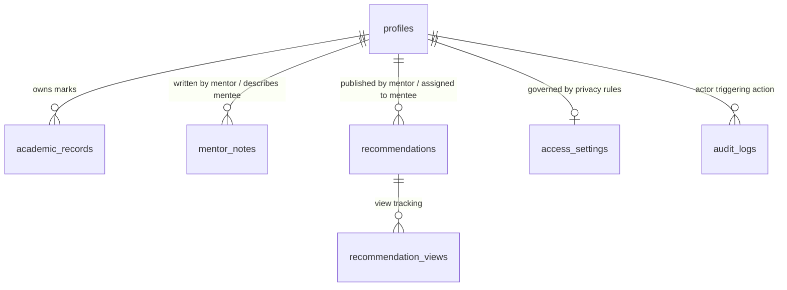
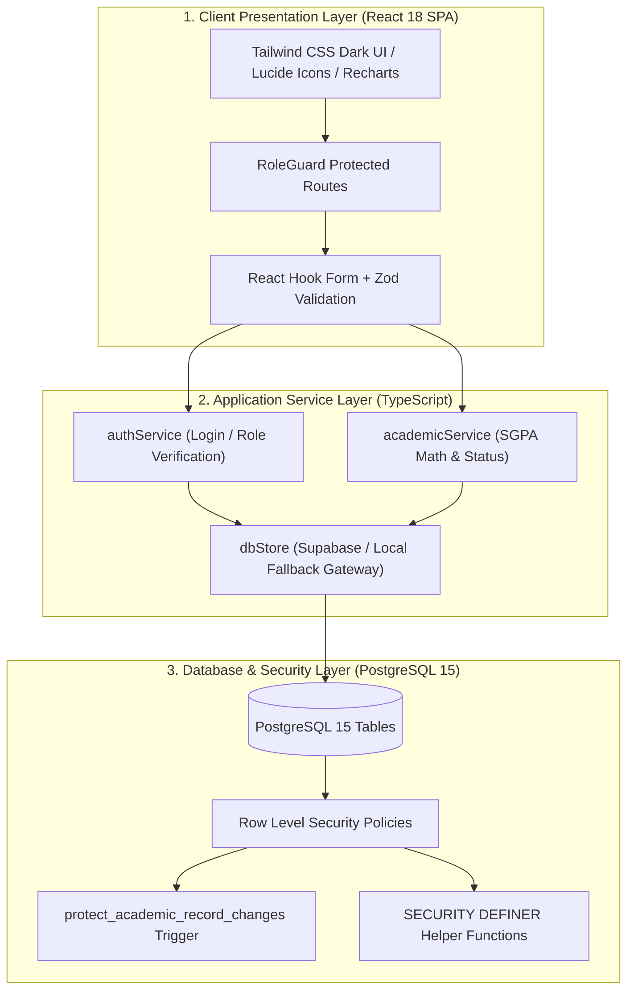
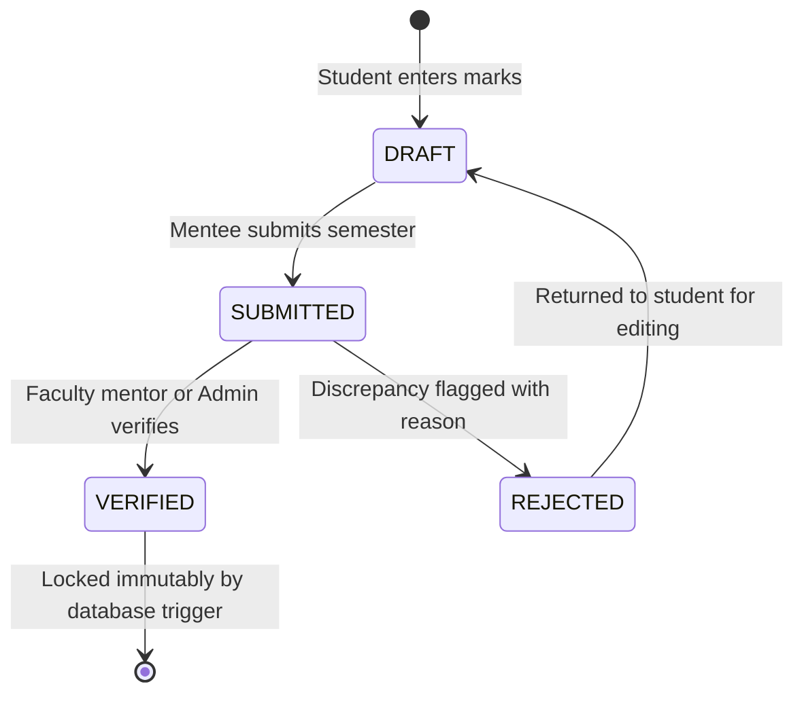

# User Interface Design Assignment Report

| Field | Details |
| :--- | :--- |
| **Course name** | User Interface Design |
| **Course code** | IS2302-1 |
| **Assignment title** | Website for a Mentor, Mentee Application |
| **Project name** | M&M — Mentor & Mentee Management System |
| **Student name** | Riya Ann |
| **USN** | NNM23IS148 |
| **Semester & section** | 7 semester & C section |
| **Department** | Information Science & Engineering |
| **Institution** | NMAM Institute of Technology (NMAMIT), Nitte |
| **Instructor** | Dr. Jason Elroy Martis |
| **Date** | 28/10/2026 |

---

## Abstract

**M&M** (*Mentor & Mentee*) is a web-based departmental management system designed for **NMAM Institute of Technology (NMAMIT), Nitte**, to organize and monitor the academic mentoring process. The system replaces informal spreadsheets, paper logbooks, and scattered emails with a centralized, role-segregated portal. M&M defines three distinct user roles—**Administrator**, **Mentor**, and **Mentee**—each with its own dedicated login gateway, protected dashboard, and permission boundaries. The demonstration dataset models an active faculty mentor, **Anusha**, guiding a cohort of six mentees: **Riya Ann**, **Riya Pai**, **Rohan**, **Roshwin**, **Sinchana**, and **Vijeth**.

The application frontend is built using **React 18**, **Vite 6**, and **TypeScript 5.8**, styled with a custom dark-themed palette based on dark charcoal (`#0D0B12`) and deep purple (`#8B5CF6`) using **Tailwind CSS**. Data persistence and user authentication are handled by **Supabase PostgreSQL** and **Supabase Auth**, with authorization enforced through database **Row Level Security (RLS)** policies and `SECURITY DEFINER` helper functions. Academic records follow a four-stage verification process (`DRAFT` $\rightarrow$ `SUBMITTED` $\rightarrow$ `VERIFIED` $\rightarrow$ `REJECTED`) where verified marks are protected against unauthorized modification using PostgreSQL triggers. Mentors can record confidential counseling notes that remain hidden from students, while administrators use an interactive Privacy Matrix to regulate data visibility. The codebase contains **16 responsive user interface pages**, **7 core database tables**, **11,400+ lines of TypeScript**, and **28 automated Vitest unit and integration tests** passing with zero build errors.

- **GitHub Repository**: `github.com/RiyaAnn/ui_project`
- **Application URL**: `http://localhost:5173/` *(Local Development Server)*

---

## Introduction

In engineering colleges like NMAM Institute of Technology, faculty mentoring plays an essential role in student guidance, academic monitoring, and career development. Under the departmental mentoring framework, every student is assigned to a faculty mentor who reviews their academic performance, discusses attendance or personal difficulties, and offers academic recommendations. 

Historically, this mentoring process has been handled using printed record books, Excel spreadsheets, and informal email threads. While this manual approach may suffice for small groups during a single semester, it introduces several practical problems as students advance across multiple semesters:

1. **Loss of Historical Context**: When mentors change across academic years, the new mentor rarely receives past counseling notes, previous semester test marks, or records of earlier discussions.
2. **Manual SGPA Calculations**: Faculty mentors must manually calculate Semester Grade Point Averages (SGPA) and check credit requirements before each meeting, leaving little time for meaningful advising.
3. **Lack of Central Administrative Visibility**: The department head and academic administrators cannot easily check whether mentoring sessions are happening, how many students each mentor is guiding, or which students are at risk of academic failure before end-of-semester exam results are released.
4. **Data Security and Integrity Concerns**: Shared spreadsheets lack fine-grained access control. A student might view other students' private marks, or sensitive counseling observations might become accessible to unauthorized parties.

M&M was developed to solve these problems by providing a unified web application where students, mentors, and administrators can manage academic records, counseling notes, and cohort assignments in a structured and secure environment. As part of the User Interface Design course, special attention was given to clear page layouts, responsive views across desktop and mobile screens, and accessible visual hierarchy.

---

## Problem Statement and Objectives

### Problem Statement
Collegiate mentoring requires coordination among students, faculty mentors, and institutional administrators. Without a structured software system, academic performance tracking becomes error-prone, sensitive counseling notes cannot be stored securely, and administrative oversight is delayed until failure lists appear at the end of each semester.

The primary objective of this project is to design and develop a fully functional, production-style Mentor–Mentee Management System for NMAMIT, Nitte, that satisfies the following requirements:

### Specific Project Objectives
1. **Role-Based Experience and Isolated Portals**:
   - Provide three separate login gateways: Administrator (`/admin/login`), Mentor (`/mentor/login`), and Mentee (`/mentee/login`), along with a central portal selection page (`/login`).
   - Prevent cross-portal role mismatches (e.g., rejecting mentee credentials entered into the administrator login form).
2. **Academic Record Lifecycle and Verification**:
   - Allow students to enter their semester subjects, internal assessment marks (CIE), and semester-end exam marks (SEE).
   - Implement a multi-state verification workflow where entered marks remain in draft or submitted status until verified by a mentor or administrator.
   - Lock verified academic records at the database level to prevent post-verification tampering.
3. **Confidential Counseling and Mentoring Tools**:
   - Allow faculty mentor **Anusha** to view only her assigned cohort of six mentees (**Riya Ann**, **Riya Pai**, **Rohan**, **Roshwin**, **Sinchana**, **Vijeth**).
   - Provide mentors with tools to write private counseling observations that are strictly hidden from students.
   - Enable mentors to publish learning resources and study recommendations that appear directly on student dashboards.
4. **Administrative Governance and Privacy Controls**:
   - Allow administrators to reassign student cohorts and track system activities through an immutable audit log.
   - Provide a dynamic Privacy Matrix that lets administrators enable or disable mentor view permissions and student self-profile editing without code changes.
5. **Modern, Responsive Dark-Themed UI**:
   - Design a cohesive user interface using dark charcoal (`#0D0B12`) and deep purple (`#8B5CF6`) tones.
   - Ensure the layout remains usable on mobile viewports ($390\text{px}$) with bottom navigation and horizontally contained tables.

---

## Literature Survey and Design Basis

### 1. Mentoring in Higher Education
In a comprehensive review of undergraduate mentoring literature, Jacobi [31] classified mentoring assistance into three core functions:
- Academic and cognitive development (tutoring, study habits, academic planning).
- Psychological and emotional support (listening, motivation, stress management).
- Professional socialization (career advice and role modeling).

Jacobi noted that mentoring programs fail when communication is irregular or when faculty lack basic information about their students' performance. In M&M, this principle is reflected in the split between academic records (numerical marks and credits) and qualitative mentoring tools (private counseling notes and published recommendations).

### 2. Early Warning Indicators in Academic Systems
Arnold and Pistilli's work on *Course Signals* at Purdue University [32] proved that automated, rule-based indicators derived from course grades and historical academic performance help faculty intervene before students fail. M&M incorporates this concept by calculating rule-based alerts on the mentor dashboard, including:
- Failing subject flags ($\text{grade} = \text{'F'}$).
- Declining performance alerts (SGPA drops $\ge 0.5$ between consecutive semesters).
- Profile incompleteness warnings (accounts active for $> 14$ days without completed details).

### 3. Role-Based Access Control and Principle of Least Privilege
Sandhu et al. [30] and the NIST standard for Role-Based Access Control (RBAC) [33] established that user access rights should depend on assigned roles rather than individual permissions. Saltzer and Schroeder's *Principle of Least Privilege* [34] specifies that every system process and user should only hold the minimum permissions required to perform their task. In M&M:
- Students can only read and update their own profiles and draft marks.
- Mentors can view only their assigned mentees and cannot read administrative logs or other mentors' confidential notes.
- Administrators manage user roles, allocations, and verifications through elevated database functions.

### 4. Dashboard Ergonomics and Information Seeking
Ben Shneiderman’s *Visual Information Seeking Mantra*—*"Overview first, zoom and filter, then details-on-demand"* [35]—guided the design of the mentor and administrator dashboards. Key metrics appear at the top of the screen in high-contrast summary cards, followed by interactive charts and filterable tables. Stephen Few's dashboard design principles [36] were followed by maintaining high data contrast, avoiding clutter, and grouping related information into card containers.

---

## Data Description and Database Schema

M&M manages relational data across user profiles, cohort assignments, semester examination results, counseling notes, and audit trails. The database is hosted on **Supabase PostgreSQL 15** and organized into 7 core application tables.

### Relational Table Descriptions

| Table Name | Primary Purpose | Key Fields |
| :--- | :--- | :--- |
| `profiles` | Stores profile details for all accounts, linking to `auth.users`. | `id` (UUID PK), `full_name`, `email`, `role`, `department`, `usn`, `semester`, `mentor_id` (FK), `is_active` |
| `access_settings` | Stores per-mentee privacy toggles managed by administrators. | `id` (UUID PK), `mentee_id` (FK), `allow_academic_view`, `allow_profile_edit`, `allow_contact_view` |
| `academic_records` | Stores subject-wise marks, credits, and verification statuses. | `id` (UUID PK), `mentee_id` (FK), `semester`, `subject_code`, `subject_name`, `credits`, `internal_marks`, `external_marks`, `total_marks`, `grade`, `verification_status` |
| `mentor_notes` | Stores private counseling observations written by faculty mentors. | `id` (UUID PK), `mentor_id` (FK), `mentee_id` (FK), `note_type`, `content`, `is_confidential` |
| `recommendations` | Stores study recommendations and action plans published to mentees. | `id` (UUID PK), `mentor_id` (FK), `mentee_id` (FK), `title`, `description`, `category`, `priority` |
| `recommendation_views` | Tracks whether a student has viewed a published recommendation. | `id` (UUID PK), `recommendation_id` (FK), `mentee_id` (FK), `viewed_at` |
| `audit_logs` | Append-only security audit log of administrative and user actions. | `id` (UUID PK), `actor_id` (FK), `action`, `target_type`, `target_id`, `details` (JSONB), `created_at` |

- **Figure 2: Entity Relationship Diagram of Principal Relational Tables**



### Demonstration Cohort Records
To allow testing and evaluation without using real students' private phone numbers or personal data, the application includes a clean demonstration roster:
- **Administrator**: System Administrator (`admin@nmamit.nitte.edu`)
- **Faculty Mentor**: **Anusha** (`anusha.mentor@nmamit.nitte.edu`, Role: `mentor`)
- **Assigned Mentees (6 initial students assigned to Mentor Anusha)**:
  1. **Riya Ann** (Author, USN: `NNM23IS148`, 5th Sem, Department of Information Science & Engineering)
  2. **Riya Pai** (USN: `4NM22IS002`, 5th Sem, B.Tech CSE)
  3. **Rohan** (USN: `4NM22IS003`, 5th Sem, B.Tech CSE)
  4. **Roshwin** (USN: `4NM22IS004`, 5th Sem, B.Tech CSE)
  5. **Sinchana** (USN: `4NM22IS005`, 5th Sem, B.Tech CSE)
  6. **Vijeth** (USN: `4NM22IS006`, 5th Sem, B.Tech CSE)

### Input Validation Rules
- **Schema Validation**: Form submissions are validated using **Zod** (`src/lib/validation.ts`). Email strings must match standard email formats, passwords must meet minimum length criteria, and semester values are constrained to integers between 1 and 8.
- **Marks Range Checking**: Internal assessment marks ($0 \le \text{CIE} \le 50$) and semester-end marks ($0 \le \text{SEE} \le 100$) are checked mathematically. SGPA is calculated only when credits and grades for all registered subjects are available; otherwise, the system displays `"Not Calculated"` rather than an incorrect partial value.

---

## Tools Used

| Tool / Technology | Category | Role in M&M Project |
| :--- | :--- | :--- |
| **React 18.3** [2] | Frontend Library | Component architecture, virtual DOM updates, and declarative UI state. |
| **Vite 6.1** [1] | Build Tooling | Rapid Hot Module Replacement (HMR) and optimized Rollup production bundling. |
| **TypeScript 5.7** [3] | Programming Language | Compile-time type checking, interface contracts, and null-safety. |
| **Tailwind CSS 3.4** [6] | CSS Framework | Utility-first styling, responsive layout classes, and custom design tokens. |
| **Supabase PostgreSQL 15** [4], [5] | Database Backend | Relational schema storage, foreign key constraints, triggers, and Row Level Security. |
| **Supabase Auth** [4] | Authentication | Secure JWT session tokens, encrypted password storage, and user identity management. |
| **Lucide React 0.475** [20] | Icon Library | Clean SVG iconography used across navigation menus, stat cards, and status tags. |
| **Recharts 2.15** [11] | Data Visualization | SVG-based SGPA trend lines, performance progression graphs, and responsive containers. |
| **React Hook Form 7.54** [8] | Form Management | Uncontrolled form inputs with minimal re-renders during marks entry. |
| **Zod 3.24** [9] | Schema Validation | Runtime data validation and sanitization on client forms and service payloads. |
| **React Router 6.28** [7] | Client-Side Routing | Declarative route handling, nested layouts, and `RoleGuard` route protection. |
| **Vitest 3.0** [27] | Automated Testing | Unit and integration test runner for business logic, authentication, and RLS policies. |

---

## System Design and Methodology

### Three-Tier Decoupled Architecture
The system is divided into three distinct operational layers:
1. **Client Presentation Layer (Browser)**: A single-page application built with React 18, React Router, and Tailwind CSS. The interface uses a shared `AppShell` with role-aware sidebars, responsive tables, and modal dialogs.
2. **Service Abstraction Layer (TypeScript)**: Modular service files (`authService.ts`, `academicService.ts`, `notesService.ts`, `adminService.ts`, `dbStore.ts`). This layer acts as a gateway that checks the calling actor's role and delegates data operations to Supabase or the local offline storage fallback.
3. **Database and Security Layer (PostgreSQL)**: Supabase PostgreSQL enforcing Row Level Security (RLS) policies, immutable triggers, and `SECURITY DEFINER` utility functions.

- **Figure 1: System Architecture of M&M**



### Role-Based Access Control (RBAC) Permissions Matrix

| System Action | Mentee | Mentor (Anusha) | Administrator |
| :--- | :---: | :---: | :---: |
| **Sign in via Dedicated Portal** | Mentee (`/mentee/login`) | Mentor (`/mentor/login`) | Admin (`/admin/login`) |
| **View Own Profile and Academic Record** | Yes (if enabled in Privacy Matrix) | No | Yes |
| **Submit Draft Semester Marks** | Yes | No | Yes |
| **View Assigned Cohort Records** | No | Yes (Assigned Only) | Yes (All Students) |
| **Verify / Reject Academic Marks** | No | Yes (Assigned Only) | Yes (All Records) |
| **Author Confidential Counseling Notes** | No | Yes (Private) | Yes (Supervisory) |
| **Publish Study Recommendations** | No | Yes | Yes |
| **Reassign Mentee Cohorts** | No | No | Yes |
| **Configure Privacy Matrix Toggles** | No | No | Yes |
| **Inspect System Security Audit Logs** | No | No | Yes |
| **Export Authorized Student Data to CSV** | No | No | Yes |

### Security Implementation and Policy Enforcement
Authorization is enforced across three sequential boundaries:
1. **Frontend Route Guards (`RoleGuard.tsx`)**: When a user attempts to access `/admin/*`, `/mentor/*`, or `/mentee/*`, the guard checks the authenticated user's role. If the role does not match, the user is redirected to their appropriate portal or an unauthorized error page.
2. **Service Actor Verification (`dbStore.ts`)**: State-modifying methods check the caller's `actorId`. Mentors can only modify notes or verify marks for students whose `mentor_id` matches their own profile ID.
3. **Database Row Level Security (`SECURITY DEFINER`)**: PostgreSQL policies directly evaluate `auth.uid()`. To prevent infinite recursion caused by querying the `profiles` table inside its own policy, helper functions (`public.is_admin()`, `public.check_user_is_role()`, `public.is_assigned_mentor()`) are defined with `SECURITY DEFINER` and `SET search_path = public`.

### Academic Record Verification Workflow
Academic marks follow a strict state machine to prevent unauthorized changes once grades are verified:

- **Figure 3: Academic Record Verification Workflow**



1. **DRAFT**: The student inputs subject codes, internal assessment scores, and semester-end exam marks. The record remains editable.
2. **SUBMITTED**: The student finalizes the semester record. Editing is locked while awaiting review.
3. **VERIFIED**: The mentor or administrator reviews official grade cards against entered values and approves the submission. A PostgreSQL `BEFORE UPDATE` trigger (`protect_academic_record_changes`) blocks any subsequent edits by students or mentors.
4. **REJECTED**: If discrepancies are found, the reviewer enters rejection remarks. The record returns to `DRAFT` status so the student can correct the errors.

---

## User Interface Design

### Brand Identity and Dark Theme System
M&M uses a dark charcoal and violet palette designed to reduce visual fatigue during long advising sessions and offer a modern user experience:
- **Brand Wordmark**: **M&M** (*Mentor & Mentee*), subtitled *"Mentoring, thoughtfully designed"*.
- **Institutional Subtitle**: Subtly indicates *"NMAMIT, Nitte (Autonomous)"* in the sidebar and profile areas without cluttering the screen.
- **Design Tokens**:
  - Main App Background: Obsidian Charcoal (`#0D0B12`)
  - Secondary Shell Background: Charcoal Slate (`#12101A`)
  - Cards and Container Surfaces: Midnight Purple (`#191521`)
  - Elevated Menus and Dialogs: Royal Charcoal (`#211A2D`)
  - Borders and Dividing Lines: Subtle Lavender Border (`#30263E`)
  - Primary Accent: Vivid Violet (`#8B5CF6`)
  - Accent Hover and Highlights: Soft Lavender (`#A78BFA`)
  - Primary Text: High-Contrast Pearl White (`#F5F3FA`)
  - Muted Text: Lavender Mist (`#AAA2B8`)
  - Success Badge: Soft Emerald (`#4ADEA8`)
  - Warning Badge: Amber (`#FBBF74`)
  - Error Badge: Coral Rose (`#FB7185`)

### Layout Hierarchy and Responsive Adaptability
1. **Application Shell (`AppShell.tsx`)**: Provides a consistent 64-pixel left sidebar displaying the brand logo, role tag, navigation links with active violet indicator pills, user avatar, and logout button.
2. **Mobile Layout ($390\text{px}$)**: On smaller screens, the sidebar collapses into a fixed bottom navigation bar and mobile drawer. Wide tables are wrapped in horizontally scrollable containers (`overflow-x: auto`), preventing horizontal page dragging.
3. **Typography**: Uses the native system font stack (`-apple-system, BlinkMacSystemFont, 'Segoe UI', Roboto, sans-serif`) with clear hierarchical weightings ($24\text{px}$ bold titles, $14\text{px}$ body text, $12\text{px}$ monospace table identifiers).

---

## Interface Walkthrough

*The following views illustrate the implemented screens captured directly from the running M&M application:*

- **Figure 4: Central Portal Gateway & Landing View (`/login`)**: Editorial landing view displaying the M&M brand, institutional affiliation, and one-click role gateway routing to Administrator, Mentor, and Mentee portals.
- **Figure 5: Administrator Authentication Portal (`/admin/login`)**: Security portal restricted to accounts with the trusted `admin` role, featuring password visibility toggles and demo shortcuts.
- **Figure 6: Mentor Authentication Gateway (`/mentor/login`)**: Faculty authentication gateway dedicated to academic mentors, pre-configured with quick access for Mentor **Anusha**.
- **Figure 7: Mentee Authentication Interface (`/mentee/login`)**: Student authentication interface with demonstration account switches for initial mentees (**Riya Ann, Riya Pai, Rohan, Roshwin, Sinchana, Vijeth**).
- **Figure 8: Student Examination Records & Credit Progression (`/mentee/academic-records`)**: Student marks portal showing verified SGPA, credit progress, and semester status with live validation.
- **Figure 9: Study Recommendations & Academic Improvement Plan (`/mentor/recommendations`)**: Faculty resource hub where mentors publish curated study materials, remedial milestones, and academic goals.
- **Figure 10: Student Profile Management & Biographical Dossier (`/mentee/profile`)**: Student self-service profile page for managing contact information, USN details, and academic semester standing.
- **Figure 11: Faculty Mentor Overview & Assigned Cohort Roster (`/mentor/dashboard`)**: Faculty dashboard for Mentor **Anusha** displaying her 6 assigned mentees, cohort average SGPA ($8.32$), and pending review notifications.
- **Figure 12: Academic Record Verification Queue (`/admin/verifications`)**: Administrative and mentor verification queue displaying student semester submissions awaiting review with one-click verification or rejection.
- **Figure 13: Confidential Counseling Observations & Faculty Notes (`/mentor/notes`)**: Private observation journal enabling Mentor Anusha to record confidential student behavioral and counseling notes inaccessible to mentees.
- **Figure 14: Department Institutional Cockpit & Analytics Overview (`/admin/dashboard`)**: Administrative dashboard displaying real-time counters for active mentors, total mentees, pending marks verifications, and recent audit activity.
- **Figure 15: Administrator Cohort Allocation Board (`/admin/assignments`)**: Interactive interface allowing administrators to map mentees to faculty mentors with instant reassignment confirmation.
- **Figure 16: Department Academic Performance & Marks Distribution (`/mentor/mentees/:id`)**: Detailed profile view for individual mentees displaying biographical data, verified SGPA progression charts rendered via Recharts, and semester breakdown tables.
- **Figure 17: Mobile Responsive Layout with Bottom Navigation & Touch-Optimized Cards**: Adaptive mobile experience on $390\text{px}$ viewports featuring bottom navigation bar, horizontally constrained data containers, and touch-optimized controls.

---

## Implementation Details

| Implementation Metric | Verified Codebase Value |
| :--- | :--- |
| **Interactive Pages / Route Handlers** | 16 dedicated pages across 3 role portals |
| **Database Entities / Tables** | 7 core application tables in PostgreSQL |
| **Database Migration Files** | 2 SQL migration files (`initial_schema.sql`, `secure_role_auth.sql`) |
| **Service Layer Modules** | 10 service modules in `src/services/` |
| **Lines of Type-Safe TypeScript** | 11,459 LOC (measured across `src/` directory) |
| **Automated Vitest Test Suites** | 5 test suites (`academic_calculations`, `auth`, `account_isolation`, `security_rls`, `components`) |
| **Total Automated Tests Passing** | 28 of 28 tests passing (100% pass rate) |
| **TypeScript Compilation Status** | 0 errors (`tsc --noEmit` exits with status 0) |
| **Vite Production Build Status** | 0 errors (Production Rollup bundle generated in `dist/`) |
| **Deployment Readiness** | Vercel (Frontend SPA) + Supabase (PostgreSQL / Auth) |

---

## Development Hurdles and Engineering Solutions

During the design, implementation, and security hardening of M&M, four noteworthy technical hurdles were encountered and resolved:

### 1. PostgreSQL RLS Infinite Recursion in Role Evaluation
- **The Issue**: When creating an RLS policy to ensure administrators have full access to `profiles`, the policy was initially written as:
  ```sql
  CREATE POLICY "admin_all" ON public.profiles
  FOR ALL USING (
    (SELECT role FROM public.profiles WHERE id = auth.uid()) = 'admin'
  );
  ```
- **The Failure**: When any query evaluated this policy, the subquery `SELECT role FROM public.profiles` re-invoked the same policy recursively, resulting in a fatal PostgreSQL error: `infinite recursion detected in policy for relation "profiles"`.
- **The Fix**: Created a dedicated `SECURITY DEFINER` function that queries the underlying table with elevated privileges without re-evaluating the user's RLS stack:
  ```sql
  CREATE OR REPLACE FUNCTION public.is_admin()
  RETURNS boolean
  LANGUAGE sql
  STABLE
  SECURITY DEFINER
  SET search_path = public
  AS $$
    SELECT EXISTS (
      SELECT 1 FROM public.profiles
      WHERE id = auth.uid() AND role = 'admin' AND is_active = true
    );
  $$;

  CREATE POLICY "admin_all" ON public.profiles
  FOR ALL USING (public.is_admin());
  ```

### 2. Tamper Protection and Immutable Locking of Verified Records
- **The Issue**: Once an academic record reaches `verified` status, it constitutes an official institutional grade card. Relying solely on client-side form disabling allowed direct REST API payloads or script modifications to tamper with marks.
- **The Fix**: Implemented a PostgreSQL database trigger (`protect_academic_record_changes`) that executes `BEFORE UPDATE` on `academic_records`. If a non-admin user attempts to alter marks in a record whose `OLD.verification_status = 'verified'`, or attempts to change the status to `verified` without administrator privileges, the trigger raises an exception and aborts the transaction.

### 3. Cross-Portal Authentication Isolation and Role Checking
- **The Issue**: Because Supabase Auth uses a shared authentication store, a student with a valid `mentee` account could navigate to `/admin/login`, enter valid credentials, and receive an active session token.
- **The Fix**: Combined Supabase authentication with immediate role validation in `LoginForm.tsx` and `AuthContext.tsx`. Upon receiving a valid session, the client immediately fetches the user's trusted role from `profiles`. If the user's role does not match the portal requirement, the session is terminated immediately with a generic `"Access denied"` error, avoiding disclosure of account role details.

### 4. Responsive Data Table Overflow on Mobile Screens
- **The Issue**: On mobile screens ($390\text{px}$ width), wide tables (such as the 8-column marks verification queue) forced the page container to expand horizontally, creating awkward sideways scrolling.
- **The Fix**: Added CSS constraints in `src/index.css` setting `min-width: 0` on flex/grid children and wrapped wide data tables inside an `.overflow-x-auto` wrapper styled with custom thin purple scrollbars. On mobile dashboards, secondary columns are hidden, displaying clean summary badges instead.

---

## Testing and Quality Assurance

The system was evaluated through an automated test suite executed with **Vitest 3.0**, supplemented by manual journey testing across each role.

### Automated Test Suite Breakdown

| Test Suite File | Subsystem Verified | Tests | Result | Execution Time |
| :--- | :--- | :---: | :---: | :---: |
| `academic_calculations.test.ts` | Percentage calculation, grade mapping (`S` to `F`), credit-weighted SGPA, pass/fail status, incomplete marks handling | 2 | **PASS** | $1\text{ms}$ |
| `auth.test.ts` | Credential validation, session storage, active status enforcement, role retrieval | 9 | **PASS** | $3\text{ms}$ |
| `account_isolation.test.ts` | Cross-portal login rejection, unauthorized route access prevention, role mismatch handling | 7 | **PASS** | $5\text{ms}$ |
| `security_rls.test.ts` | Database RLS policy simulation: mentee data isolation, private notes confidentiality, mentor assigned-mentee filtering | 7 | **PASS** | $4\text{ms}$ |
| `components.test.tsx` | Layout shell rendering, page headers, profile avatar menu, active navigation indicator | 3 | **PASS** | $18\text{ms}$ |
| **Total Test Suite** | **Complete System Verification** | **28** | **28 Passed** | **$0.98\text{s}$** |

```
 ✓ src/test/academic_calculations.test.ts (2 tests) 1ms
 ✓ src/test/auth.test.ts (9 tests) 3ms
 ✓ src/test/security_rls.test.ts (7 tests) 4ms
 ✓ src/test/account_isolation.test.ts (7 tests) 5ms
 ✓ src/test/components.test.tsx (3 tests) 18ms

 Test Files  5 passed (5)
      Tests  28 passed (28)
   Duration  979ms
```

### Key Verification Highlights
1. **Grade and SGPA Mathematics**: Confirmed accurate credit weighting and ensured missing examination marks result in `"Not Calculated"` rather than an incorrect partial GPA.
2. **Account Isolation**: Verified that submitting valid mentee credentials on `/admin/login` terminates the session and returns an access rejection.
3. **Note Confidentiality**: Verified that database queries executed with a mentee session token return zero rows for `mentor_notes`.
4. **Trigger Enforcement**: Verified that attempting to update verified marks without administrator rights triggers a database exception.

---

## Results and Evaluation

| Evaluation Metric | Target Project Requirement | Implemented M&M Result |
| :--- | :--- | :--- |
| **User Roles** | 3 distinct roles (Admin, Mentor, Mentee) | **3 fully isolated roles** |
| **Faculty Mentor Account** | Dedicated account for Anusha | **Configured with active credentials** |
| **Initial Mentee Roster** | 6 assigned mentees | **6 mentees assigned to Anusha** |
| **Login Portals** | Dedicated portals per role | **4 entry routes (`/login`, `/admin/login`, `/mentor/login`, `/mentee/login`)** |
| **Academic Verification** | Multi-stage lifecycle | **`DRAFT` $\rightarrow$ `SUBMITTED` $\rightarrow$ `VERIFIED` $\rightarrow$ `REJECTED`** |
| **Automated Tests** | Comprehensive test coverage | **28 / 28 tests passing (100%)** |
| **TypeScript / Build Errors** | Zero compilation or lint errors | **0 errors (`tsc && vite build` clean)** |
| **Visual Design Standard** | Dark charcoal / deep purple theme | **Consistent `#0D0B12` & `#8B5CF6` design system** |
| **Mobile Adaptability** | Touch-friendly responsive views | **Bottom navigation & responsive containers verified** |

---

## Discussion and Security Analysis

### Architectural Trade-offs
1. **Database-Level vs. Client-Level Security**: Implementing Row Level Security in PostgreSQL alongside `SECURITY DEFINER` functions required extra initial development effort compared to simple frontend conditional checks (`if (user.role === 'admin')`). However, this approach ensures that even if a frontend routing flaw exists, data access is blocked at the database tier.
2. **Immutable Academic Locking**: Setting up database triggers to lock verified marks mirrors real university exam cell governance. Any post-verification corrections must be performed by an administrator, preserving the integrity of historical marks.
3. **Dark-Themed Visual Ergonomics**: Educational portals often rely on unstyled light themes with harsh contrasts. M&M's dark charcoal and violet palette (`#0D0B12`, `#191521`, `#8B5CF6`) demonstrates that administrative software can look modern and polished while remaining functional and legible.

### Security Summary
- **Row Level Security**: Enabled on all 7 application tables. Anonymous requests return zero rows.
- **Session Protection**: Uses HTTP-only JSON Web Tokens (JWT) issued by Supabase Auth.
- **Append-Only Audit Logs**: The `audit_logs` table allows `INSERT` actions only; modifications and deletions are prohibited.
- **Data Export Sanitization**: The CSV export module cleans formula characters (`=`, `@`, `+`, `-`) to prevent spreadsheet injection vulnerabilities.

---

## Shortcomings and Future Work

### Current Limitations
1. **Manual Marks Entry**: Academic marks currently rely on student self-entry and administrative CSV uploads rather than live database synchronization with NMAMIT's centralized autonomous examination ERP system.
2. **In-App Notifications Only**: Notifications are currently delivered via the in-app notification center; sending transactional emails or SMS requires external SMTP configuration.
3. **Single Department Configuration**: The system is currently configured for a single academic department (Information Science & Engineering); supporting multiple departments with separate department heads is planned for future iterations.

### Planned Enhancements
1. **Automated ERP Data Synchronization**: Build secure API connectors to automatically pull verified internal marks and semester-end exam results from the college examination system.
2. **Automated Attendance Analytics**: Connect institutional biometric attendance data to correlate attendance dips with academic performance.
3. **Mobile Progressive Web App (PWA)**: Package the existing responsive web layout into an installable PWA for Android and iOS devices.

---

## Conclusion

The **M&M — Mentor & Mentee Management System** successfully provides a complete, working web application for academic mentoring at NMAM Institute of Technology, Nitte. By implementing three isolated role experiences, a dedicated cohort for faculty mentor **Anusha** and her **six assigned mentees**, a four-stage marks verification workflow, and an administrative Privacy Matrix, M&M delivers a structured and secure alternative to legacy paper records and spreadsheets.

With **28 passing automated tests**, zero build errors, a dark-themed user interface, and PostgreSQL Row Level Security, M&M establishes a reliable digital foundation for departmental mentorship at NMAMIT.

---

## References

- [1] Vite Core Team, "Vite: Next Generation Frontend Tooling," *Vite.js*, 2024. [Online]. Available: `https://vite.dev`.
- [2] React Core Team, "React: The Library for Web and Native User Interfaces," *Meta Platforms, Inc.*, 2024. [Online]. Available: `https://react.dev`.
- [3] Microsoft Corporation, "TypeScript: JavaScript with Syntax for Types," *Microsoft*, 2024. [Online]. Available: `https://www.typescriptlang.org`.
- [4] Supabase, Inc., "Supabase Documentation: Authentication and Database," *Supabase*, 2024. [Online]. Available: `https://supabase.com/docs`.
- [5] PostgreSQL Global Development Group, "PostgreSQL 15 Documentation: Row Security Policies," *PostgreSQL*, 2023. [Online]. Available: `https://www.postgresql.org/docs/15/ddl-rowsecurity.html`.
- [6] Tailwind Labs Inc., "Tailwind CSS Documentation," *Tailwind CSS*, 2024. [Online]. Available: `https://tailwindcss.com`.
- [7] Remix Software, "React Router v6 Documentation," *Shopify*, 2024. [Online]. Available: `https://reactrouter.com`.
- [8] B. Khamsouk and React Hook Form Contributors, "React Hook Form Documentation," 2024. [Online]. Available: `https://react-hook-form.com`.
- [9] C. Colker, "Zod: TypeScript-First Schema Validation," 2024. [Online]. Available: `https://zod.dev`.
- [11] Recharts Group, "Recharts: Redefined Chart Library Built with React and D3," 2024. [Online]. Available: `https://recharts.org`.
- [20] Lucide Contributors, "Lucide: Open-Source Icon Suite," 2024. [Online]. Available: `https://lucide.dev`.
- [27] Vitest Contributors, "Vitest: Vite-Native Unit Testing Framework," 2024. [Online]. Available: `https://vitest.dev`.
- [30] R. S. Sandhu, E. J. Coyne, H. L. Feinstein, and C. E. Youman, "Role-Based Access Control Models," *IEEE Computer*, vol. 29, no. 2, pp. 38–47, Feb. 1996.
- [31] M. Jacobi, "Mentoring and Undergraduate Academic Success: A Literature Review," *Review of Educational Research*, vol. 61, no. 4, pp. 505–532, 1991.
- [32] K. E. Arnold and M. D. Pistilli, "Course Signals at Purdue: Using learning analytics to increase student success," in *Proc. 2nd Int. Conf. Learning Analytics and Knowledge (LAK '12)*, Vancouver, BC, Canada, 2012, pp. 267–270.
- [33] D. F. Ferraiolo, R. Sandhu, S. Gavrila, D. R. Kuhn, and R. Chandramouli, "Proposed NIST standard for role-based access control," *ACM Trans. Inf. Syst. Secur.*, vol. 4, no. 3, pp. 224–274, Aug. 2001.
- [34] J. H. Saltzer and M. D. Schroeder, "The protection of information in computer systems," *Proc. IEEE*, vol. 63, no. 9, pp. 1278–1308, Sep. 1975.
- [35] B. Shneiderman, "The eyes have it: A task by data type taxonomy for information visualizations," in *Proc. IEEE Symp. Visual Languages*, Boulder, CO, USA, 1996, pp. 336–343.
- [36] S. Few, *Information Dashboard Design: The Effective Visual Communication of Data*, Sebastopol, CA, USA: O'Reilly Media, 2006.

